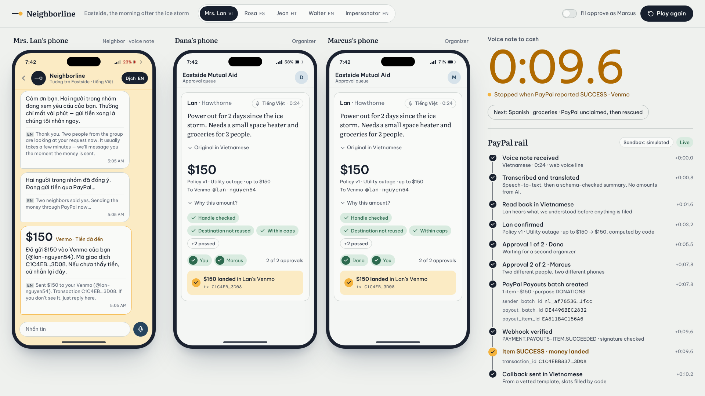
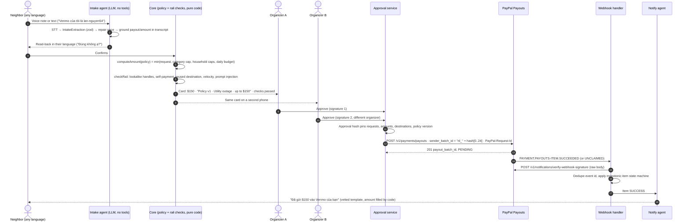

# Neighborline

[](https://github.com/Aaaaarin/neighborline/actions/workflows/ci.yml)
[](LICENSE)


**A hotline, not a dashboard.** A neighbor leaves a voice note in their own language. Two volunteer organizers
approve it on their phones. PayPal or Venmo cash lands. Then the neighbor gets a message back in their language.



<sub>The `/demo` stage, sped up 3×. Left: the neighbor's phone. Middle: two organizers. Right: every PayPal event,
with the stopwatch that stops when PayPal reports `SUCCESS`. The stage runs in fake/fixture mode: see
[Sandbox reality](#sandbox-reality).</sub>

Built for the [PayPal AI Hackathon](https://paypalaihackathon.devpost.com/). MIT licensed.

---

## Contents

[Try it in 30 seconds](#try-it-in-30-seconds) · [The problem](#the-problem) · [How it works](#how-it-works) ·
[What the AI does, and never does](#what-the-ai-does-and-never-does) · [PayPal integration](#paypal-integration) ·
[MCP server](#the-mcp-server-payouts-for-agents-with-two-humans-in-the-loop) · [AI tools used](#ai-tools-used) ·
[Architecture](#architecture) · [Testing](#testing) · [Sandbox reality](#sandbox-reality) ·
[Live-mode reality](#live-mode-reality) · [Accessibility](#accessibility) · [Roadmap](#roadmap) · [Docs](#docs)

## Try it in 30 seconds

**Hosted:** `https://<hosted-url-coming-soon>` *(placeholder: the hosted demo is not deployed yet)*

**Locally, with no credentials:**

```bash
corepack enable            # pnpm 10 (pinned in package.json)
pnpm i && pnpm dev         # Node 22 recommended (engines: >=20)
open http://localhost:3000/demo
```

Press **Play scenario**. Mrs. Lan's Vietnamese voice note becomes a $150 Venmo payout in about 10 seconds of stage
time. Then try:

| URL | What you see |
|---|---|
| [`/demo?scenario=rosa`](http://localhost:3000/demo?scenario=rosa) | Spanish request. The PayPal payout comes back `UNCLAIMED`, the claim help goes out in Spanish, then `SUCCESS` |
| [`/demo?scenario=blocked`](http://localhost:3000/demo?scenario=blocked) | Injected instructions plus a lookalike of the group's Venmo handle. Blocked before any money moves |
| [`/demo?scenario=lan&mode=manual`](http://localhost:3000/demo?scenario=lan&mode=manual) | You are the second organizer. Nothing is paid until you tap **Approve $150** |
| [`/call`](http://localhost:3000/call) | The neighbor's phone. Record, type, or use a sample voice note |
| [`/trust`](http://localhost:3000/trust) | Fiscal-sponsor checklist, what each agent may do, and what is simulated |

`pnpm dev` runs with `PAYPAL_MODE=fake` and `AI_MODE=fixture`. No PayPal or model keys are needed. All recording
URL parameters are in [docs/DEMO.md](docs/DEMO.md).

## The problem

Neighborhood mutual-aid groups move real money during disasters. They mostly run on spreadsheets and volunteers'
personal Venmo accounts.

- **Intake chaos.** After the January 2025 Eaton fire, Mutual Aid LA Network asked on Instagram for relief offers
  and got about 300 comments overnight. Two volunteers turned them into a spreadsheet whose link "broke several
  times." ([LA Public Press](https://lapublicpress.org/2025/01/altadena-pasadena-mutual-aid-la-fires-eaton/))
- **Scale.** Mutual Aid LA moved about $1.44M between January and April 2025 after the fires. *(source needed: this
  figure is in our research notes without a primary link)*
- **Frozen accounts.** Venmo suspended SanctuaryDMV's account for about 6 days over the 2022–23 New Year during a
  "routine review," costing the group thousands of dollars in donations.
  ([DCist](https://dcist.com/story/23/01/04/venmo-sanctuarydmv-mutual-aid-migrants-dc))
- **Impersonation.** Fake Venmo accounts copy a charity's handle with a one-character change and ask real supporters
  for money. ([Chronicle of Philanthropy, Apr 2026](https://www.philanthropy.com/solutions/scammers-are-spoofing-charities-on-venmo-how-to-protect-your-donors/))
  California's Attorney General warned that fire-relief scammers targeted elderly people, immigrants and non-English
  speakers. ([ABC7](https://abc7.com/post/scam-artists-are-taking-advantage-la-fires-california-attorney-general-rob-bonta-warns/15793513/))
- **Language.** The people who most need fast cash are often the people least served by English-only Google Forms.

Neighborline is the safe payout desk for these groups. It handles multilingual intake, applies the group's own rules
in code, requires two approvals, and pays through PayPal Payouts from a fiscal sponsor's business account. It never
uses a volunteer's personal Venmo.

## How it works



The [architecture doc](docs/ARCHITECTURE.md) has the state machines and the idempotency design.

## What the AI does, and never does

| The AI does | The AI never does |
|---|---|
| Transcribe a voice note (STT) | Compute an amount. `computeAmount` in [`packages/core/src/amounts.ts`](packages/core/src/amounts.ts) does |
| Translate it and extract fields into a zod-validated `IntakeExtraction` | Decide eligibility, score need, or score "fraud risk" of a person |
| Read the request back to the neighbor in their language | Hold PayPal credentials or call Payouts. The intake agent has no tools at all |
| Ask **one** clarifying question when something is missing or unclear | Guess. A payout handle or amount that the neighbor did not say is dropped, and the neighbor is asked again |
| Draft a policy from organizers' plain-English rules | Activate a policy. That needs two organizer approvals ([`packages/db/src/repo/groups.ts`](packages/db/src/repo/groups.ts)) |
| Translate status messages into languages outside the vetted catalog, with a back-translation fact check | Write money text freely. Messages come from a vetted catalog and code fills `{amount}` and `{wallet}` |
| Write a donor report narrative from aggregate facts | Use a number that is not in the facts. Ungrounded numbers trigger a repair, then a deterministic template |

Every model output goes through **validate → repair once → re-ask the human**, and leaves a trace the UI can show
(`IntakeExtraction valid on first try · 812 ms`, `Schema repaired 1 field (payout.value)`). See [docs/AI.md](docs/AI.md).

## PayPal integration

Everything below is implemented in [`@neighborline/paypal`](packages/paypal) and tested against
[`tools/fake-paypal`](tools/fake-paypal), a local PayPal look-alike, unless the last column says otherwise. Verified
API facts and sources are in [docs/PAYPAL.md](docs/PAYPAL.md).

| PayPal feature | Endpoint / surface | Why we use it | Code |
|---|---|---|---|
| OAuth 2.0 client credentials | `POST /v1/oauth2/token` | Cached token, early single-flight refresh, one refresh on 401 | [`client.ts`](packages/paypal/src/client.ts) |
| **Payouts**: create batch | `POST /v1/payments/payouts` | One batch pays PayPal and Venmo recipients together | [`payouts.ts`](packages/paypal/src/payouts.ts) |
| **Payouts**: idempotency | `sender_batch_id` + `PayPal-Request-Id` | `sender_batch_id` is derived from the two-person approval hash. Retries and double taps return the original batch | [`payouts.ts`](packages/paypal/src/payouts.ts), [`core/approvals.ts`](packages/core/src/approvals.ts) |
| **Payouts**: duplicate resolution | HATEOAS link in the duplicate-batch error | Follows PayPal's link to the original batch instead of failing | [`payouts.ts`](packages/paypal/src/payouts.ts) |
| **Payouts**: Venmo | `recipient_wallet: VENMO`, `USER_HANDLE`, required `note`, `application_context.social_feed_privacy: PRIVATE` | Venmo is where many neighbors already are. Aid is never posted to a public feed | [`payouts.ts`](packages/paypal/src/payouts.ts) |
| **Payouts**: purpose code | `items[].purpose` | Aid must not be labeled a goods sale (PayPal's default is `GOODS`). The value is checked against PayPal's enum | [`payouts.ts`](packages/paypal/src/payouts.ts) |
| **Payouts**: language | `items[].notification_language` | PayPal's claim email for recipients without an account, in their language | [`payouts.ts`](packages/paypal/src/payouts.ts) |
| **Payouts**: status | `GET /v1/payments/payouts/{id}` (paginated), `GET /v1/payments/payouts-item/{id}` | Item status and PayPal's reason (e.g. `RECEIVER_UNREGISTERED`) | [`payouts.ts`](packages/paypal/src/payouts.ts) |
| **Payouts**: cancel unclaimed | `POST /v1/payments/payouts-item/{id}/cancel` → `RETURNED` | Wrong destination: get the money back before the 30-day auto-return | [`payouts.ts`](packages/paypal/src/payouts.ts) |
| Item status machine | All 10 item statuses; the 9 documented item webhook events, plus `REVERSED` mapped defensively | Late, duplicate and out-of-order webhooks never regress `SUCCESS` | [`payout-status.ts`](packages/paypal/src/payout-status.ts), [`core/state.ts`](packages/core/src/state.ts) |
| **Webhooks**: verify | `POST /v1/notifications/verify-webhook-signature` | The raw body is spliced in byte-for-byte, because PayPal signs a CRC32 of the exact bytes | [`webhooks.ts`](packages/paypal/src/webhooks.ts) |
| Webhooks: typed events | `PAYMENT.PAYOUTS-ITEM.*`, `PAYMENT.PAYOUTSBATCH.*`, `CHECKOUT.ORDER.APPROVED`, `PAYMENT.CAPTURE.COMPLETED`, `BILLING.SUBSCRIPTION.ACTIVATED`, `PAYMENT.SALE.COMPLETED` | Discriminated union, dedupe on event id | [`webhook-events.ts`](packages/paypal/src/webhook-events.ts) |
| Webhooks: simulator | `POST /v1/notifications/simulate-event` | Wiring tests. Simulated events cannot be verified, which is PayPal's documented behavior | [`webhooks.ts`](packages/paypal/src/webhooks.ts) |
| **Orders v2** (donations) | `POST /v2/checkout/orders`, `POST /v2/checkout/orders/{id}/capture`, `GET` | One-time gifts. `items[].category: DONATION`, `NO_SHIPPING`. Capture is idempotent (`ORDER_ALREADY_CAPTURED` returns the existing capture) | [`orders.ts`](packages/paypal/src/orders.ts) |
| **Subscriptions** (monthly gifts) | `POST/GET /v1/catalogs/products`, `POST/GET /v1/billing/plans`, `GET /v1/billing/subscriptions/{id}` | `ensureDonationTiers` creates $10/$25/$50 monthly plans idempotently | [`subscriptions.ts`](packages/paypal/src/subscriptions.ts) |
| **Transaction Search** | `GET /v1/reporting/transactions` | Reconcile payouts against PayPal's ledger. Ranges over 31 days are chunked. Items younger than the 3-hour reporting lag are `pendingLag`, not errors | [`reporting.ts`](packages/paypal/src/reporting.ts), [`reconcile.ts`](packages/paypal/src/reconcile.ts) |
| **JS SDK** | Smart Buttons with `enable-funding=venmo,paylater`, Pay Later `messages`, subscriptions with `vault=true` | Donor page. Without `NEXT_PUBLIC_PAYPAL_CLIENT_ID` it shows a clearly labeled simulated button | [`DonateForm.tsx`](apps/web/components/donate/DonateForm.tsx) |
| **Agent Toolkit** | `@paypal/agent-toolkit`, tool `list_transactions` only | Donation inflows for the transparency report. Called with fixed arguments: no model chooses the call | [`inflows.ts`](packages/agents/src/report/inflows.ts) |
| Negative testing | `PayPal-Mock-Response` header (Orders); `ERRPYO*` test values in `items[0].note` (Payouts) | Error paths in sandbox | [`client.ts`](packages/paypal/src/client.ts), [`fake-paypal`](tools/fake-paypal) |
| Errors and retries | `{name, debug_id, details[]}` | Typed errors carry `debug_id`. Only 429 and 5xx are retried, with jitter and `Retry-After`. Writes replay only with an idempotency key | [`errors.ts`](packages/paypal/src/errors.ts), [`retry.ts`](packages/paypal/src/retry.ts) |

> **Integration status (Oct 16, 2026).** The packages above are complete and tested. The web app's routes currently
> run on an in-memory engine ([`apps/web/lib/server/mock-engine.ts`](apps/web/lib/server/mock-engine.ts)) that emits
> the same events. Wiring the routes to `@neighborline/core`, `/db`, `/paypal` and `/agents` is in progress (see
> [`apps/web/INTEGRATION.md`](apps/web/INTEGRATION.md)). Until it lands, the stage's PayPal ids are generated locally
> and labeled "Sandbox: simulated".

## The MCP server: Payouts for agents, with two humans in the loop

The [PayPal Agent Toolkit](https://github.com/paypal/agent-toolkit) covers orders, invoices, subscriptions and
reporting. It has no Payouts tools, and Payouts is the API you least want a model to call on its own.
`@neighborline/paypal` ships **`neighborline-payouts-mcp`**, an MCP server that fills that gap
([`packages/paypal/src/mcp/server.ts`](packages/paypal/src/mcp/server.ts)):

| Tool | Effect |
|---|---|
| `get_payout_batch`, `get_payout_item` | Read-only status, including PayPal's failure reason |
| `search_transactions`, `reconcile_payouts` | Read-only ledger and reconciliation |
| `cancel_unclaimed_payout_item` | Returns money **to the sender**. Works only on `UNCLAIMED` items |
| `create_payout_batch` | **Moves money. Requires an `approval_token`** |

The approval token is an HMAC over the `sender_batch_id`, a digest of every item's receiver, amount, currency and
wallet, the approver ids, and an expiry ([`approval.ts`](packages/paypal/src/approval.ts)). The verifier refuses
the call if one cent or one receiver changes, if the token has expired, or if fewer than two distinct approvers
signed it. **The default verifier refuses everything**, so an unconfigured server cannot pay anyone.

```bash
# stdio, for any MCP client
PAYPAL_MODE=sandbox PAYPAL_CLIENT_ID=… PAYPAL_CLIENT_SECRET=… \
NEIGHBORLINE_APPROVAL_SECRET=<at least 32 chars> pnpm --filter @neighborline/paypal mcp
```

Our own agents use the Agent Toolkit for what it covers (`list_transactions`) and this server for what it doesn't.

## AI tools used

The hackathon asks every entry to list the AI it uses.

**In the product** ([`packages/agents/src/providers`](packages/agents/src/providers)):

| Job | Provider and default model | How it is called |
|---|---|---|
| Structured extraction, repair, policy drafting, report narrative, out-of-catalog translation | **Anthropic Claude**, `claude-sonnet-5-5` (`ANTHROPIC_MODEL`) | Messages API, one forced tool call with `strict: true` (constrained decoding to the JSON Schema), then zod validation |
| Same, alternative provider | **OpenAI**, `gpt-5.4-mini` (`OPENAI_MODEL`) | Chat Completions Structured Outputs (`json_schema`, `strict: true`), then zod validation |
| Speech-to-text | **OpenAI** `gpt-4o-transcribe` (`OPENAI_STT_MODEL`; `whisper-1` also works) | Audio transcription |
| Read-back and callback voice | **OpenAI** `gpt-4o-mini-tts`, voice `coral` | Text-to-speech, with browser speech as the fallback |
| Offline mode (default) | Fixture providers | Deterministic outputs keyed to the demo scenarios. Used by every test and by `pnpm dev` |

`AI_MODE=live` selects real providers. `LLM_PROVIDER` chooses Anthropic or OpenAI and falls back to whichever key
exists. `AI_FALLBACK=fixture` falls back to fixtures on model errors and logs it.

**To build it:** the code, tests and docs were written by **Claude Code** agents (Claude Opus 5.5) working in
parallel lanes (core/db, payments, AI, web, docs), steered by two humans. Lanes communicated through `NOTES-*.md`
files and the shared zod contract in `packages/core/src/schemas.ts`. [THREAT_MODEL.md](THREAT_MODEL.md#reviewing-ai-written-code)
describes how AI-written code is checked.

## Architecture

```
apps/web            Next.js 15 (App Router) + Tailwind 4. Pages /, /demo, /call, /organizer, /donate,
                    /report, /trust, /ledger and the /api/* route handlers. One seam: lib/server/services.ts
packages/core       Domain contract (zod), policy engine, amounts, rail protection, approvals + hashing,
                    state machines, i18n catalog, transparency report math. Pure: no I/O
packages/db         Drizzle schema + repositories. Postgres in production, PGlite (embedded) for dev/tests.
                    Two-signature table, append-only hash-chained audit log
packages/paypal     @neighborline/paypal: typed PayPal client + neighborline-payouts-mcp (publishable, MIT)
packages/agents     LLM/STT/TTS providers + intake, policy compiler, notify and report agents
tools/fake-paypal   Local PayPal look-alike: OAuth, Payouts, Orders, Billing, Transaction Search, signed webhooks
```

`packages/core` depends on nothing but zod. `db` and `agents` depend on `core`. `paypal` stands alone so it can be
published, and [a drift test](packages/paypal/src/core-compat.test.ts) keeps its state machine identical to core's.
More in [docs/ARCHITECTURE.md](docs/ARCHITECTURE.md).

## Testing

| Package | Unit tests | What they cover |
|---|---|---|
| `packages/core` | 259 | Amounts and caps, lookalike/confusable handles, multilingual prompt-injection heuristics (including polite pleas that must not flag), approval hashing (NIST SHA-256 vectors), state machines, i18n, k-anonymous report |
| `packages/db` | 57 | Two distinct signers, voiding on content change, idempotent batch creation, out-of-order webhooks, append-only audit (UPDATE/DELETE/TRUNCATE rejected), migration drift |
| `packages/agents` | 93 | Validate → repair → re-ask, grounding (an injected "$5000 to @x" is dropped), data-tag escape, back-translation fact check, report number grounding |
| `packages/paypal` | 79 | Payouts idempotency and duplicate resolution, Venmo rules, raw-body webhook verification, retries, Transaction Search chunking, reconcile, MCP approval tokens |
| `tools/fake-paypal` | 14 | The fake's own contract |
| `apps/web` (Playwright) | 14 | Lan → `SUCCESS` with the clock frozen, a visitor approving as the second organizer, lookalike blocked, approval idempotency over HTTP, mobile `/call`, and axe WCAG 2.1 AA checks on all 8 pages plus the dark-mode stage |

```bash
pnpm test                                    # all unit tests (vitest), offline
pnpm typecheck                               # tsc --noEmit, strict + noUncheckedIndexedAccess
pnpm --filter @neighborline/paypal build     # tsup → dist (ESM + d.ts)
pnpm --filter @neighborline/web test:e2e     # builds and serves on :3100, runs Playwright
```

CI ([`.github/workflows/ci.yml`](.github/workflows/ci.yml)) runs all of these, a dependency audit and a gitleaks
secret scan on every push and pull request.

## Sandbox reality

What is real and what is simulated today:

| | Status |
|---|---|
| `/demo`, `/call`, `/organizer` and the other pages | Run on the in-memory engine. PayPal ids are generated locally and marked "Sandbox: simulated" |
| `@neighborline/paypal` against PayPal's API shapes | Tested against `tools/fake-paypal`, which mirrors the documented request and response shapes, error bodies and webhook headers. The fake signs webhooks with HMAC where PayPal uses RSA |
| Real PayPal sandbox | Supported by `PAYPAL_MODE=sandbox`. The sandbox spike list is in [docs/PAYPAL.md](docs/PAYPAL.md#to-verify-in-the-real-sandbox) |
| Venmo payouts in sandbox | **Unverified.** PayPal documents only a mock (`POSPYO003`). Sandbox also rejects `recipient_type: PHONE` |
| Webhook simulator events | Cannot be verified by PayPal's postback API (documented). Real deliveries can |
| Transaction Search | Lags up to 3 hours. Reconcile reports young items as `pendingLag` |
| Speech, translation, read-back | Fixture mode replays prepared transcripts. `AI_MODE=live` calls real models |
| SMS, WhatsApp and phone callbacks | Not built. Messages appear on the neighbor's in-browser phone |

## Live-mode reality

Running this with real money needs more than code:

- **A fiscal sponsor.** Donations land in a 501(c)(3) sponsor's PayPal Business account, not a volunteer's.
- **Payouts permission.** The [Payouts Agreement](https://pep.paypal.com/legalhub/paypal-payouts-agreement) requires
  a business account in good standing and PayPal's approval, and it excludes "sending money to family and friends."
- **Charity pre-approval.** PayPal's [Acceptable Use Policy](https://www.paypal.com/us/legalhub/paypal/acceptableuse-full)
  requires pre-approval for collecting donations as a charity.
- **Venmo payouts are US-only**, and a `note` is required.
- **Transaction Search permission** must be enabled on the REST app.
- **SMS** needs carrier registration (US toll-free verification or A2P 10DLC), which takes days. This is why callbacks
  are on the roadmap rather than in the demo.
- **Organizer authentication.** The demo has none: organizer ids come from the request. See
  [THREAT_MODEL.md](THREAT_MODEL.md).

The `/trust` page shows the fiscal-sponsor checklist on screen.

## Accessibility

- WCAG 2.2 AA targets: text contrast ≥ 4.5:1 (body ≥ 7:1), every pair measured in [apps/web/DESIGN.md](apps/web/DESIGN.md).
- Axe checks for WCAG 2.1 AA run in CI on every page and on the finished stage in dark mode.
- Tap targets ≥ 44×44 px. The record button is 132 px and approve buttons are 56 px tall.
- The neighbor's conversation, the approval count and the stopwatch result live in `aria-live="polite"` regions,
  so screen readers hear status changes, including the moment money arrives.
- Hold-to-record also works as press-to-toggle with Space or Enter.
- Each message carries its language (`lang="vi"`, `lang="es"`, `lang="ht"`) so screen readers switch voices.
  (Core exposes `textDirection('ar') === 'rtl'`, but the web UI does not apply right-to-left layout yet.)
- Status is never shown by color alone. `prefers-reduced-motion` removes motion but keeps state changes.

## Roadmap

Not built yet, in rough priority order:

1. Finish wiring the web routes to the real packages (in progress), then run the real PayPal sandbox spike.
2. Organizer authentication (passkeys) and device binding for approvals.
3. Run the approval service as a separate process that alone holds the Payouts credentials.
4. A scheduled nightly reconcile against Transaction Search (the function exists; the schedule does not).
5. Voice hotline and WhatsApp intake (Twilio), then SMS once carrier registration clears.
6. Audio deletion after transcription and PII redaction in logs.
7. Vetted catalog text for French, Tagalog, Korean and Russian (today they get a checked LLM translation or English).
8. Hosting on Render.

Good first issues are listed in [docs/GOOD_FIRST_ISSUES.md](docs/GOOD_FIRST_ISSUES.md).

## Docs

| | |
|---|---|
| [docs/ARCHITECTURE.md](docs/ARCHITECTURE.md) | Package boundaries, data model, state machines, idempotency |
| [docs/PAYPAL.md](docs/PAYPAL.md) | PayPal deep dive, with sources |
| [docs/AI.md](docs/AI.md) | The structured-output pipeline, grounding, prompt injection |
| [docs/DEMO.md](docs/DEMO.md) | Running each scenario, recording parameters |
| [THREAT_MODEL.md](THREAT_MODEL.md) | STRIDE for the money path, residual risks |
| [CONTRIBUTING.md](CONTRIBUTING.md) | Setup, lanes, adding a language or a rail check |
| [SECURITY.md](SECURITY.md) | Reporting a vulnerability |
| [SPEC.md](SPEC.md) | Product and engineering spec |

## License

[MIT](LICENSE). `@neighborline/paypal` is also MIT and is built to be published on its own.
