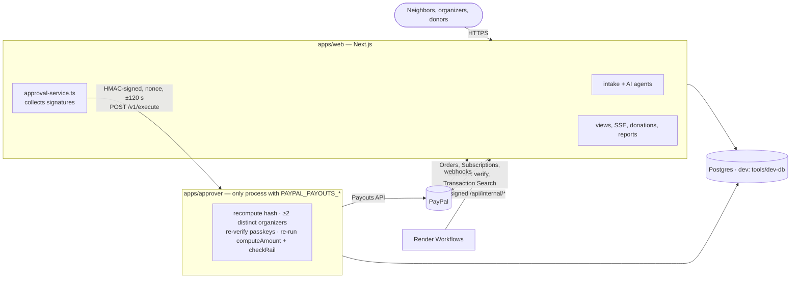
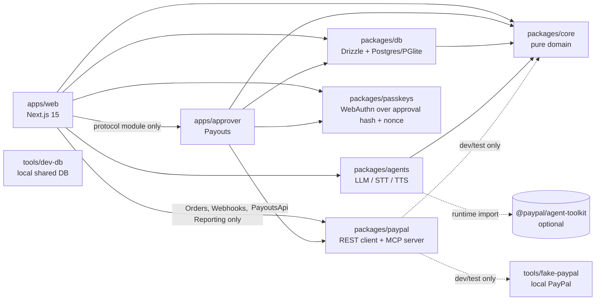
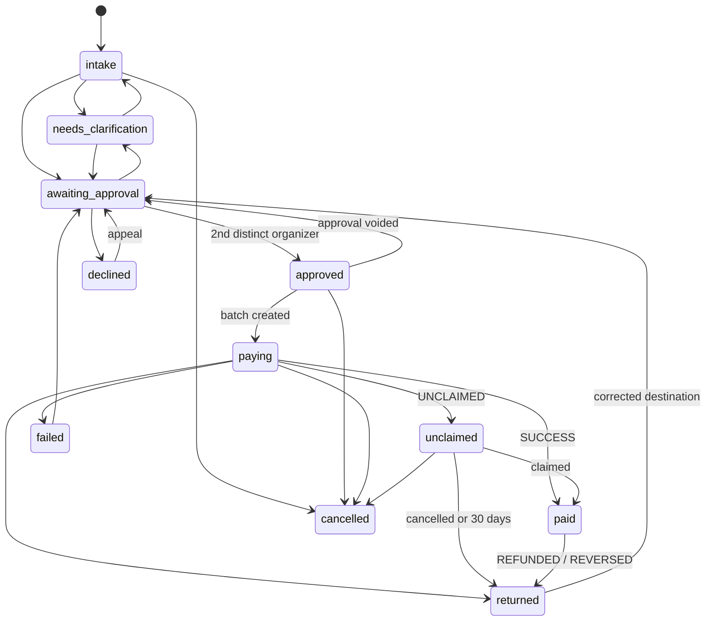
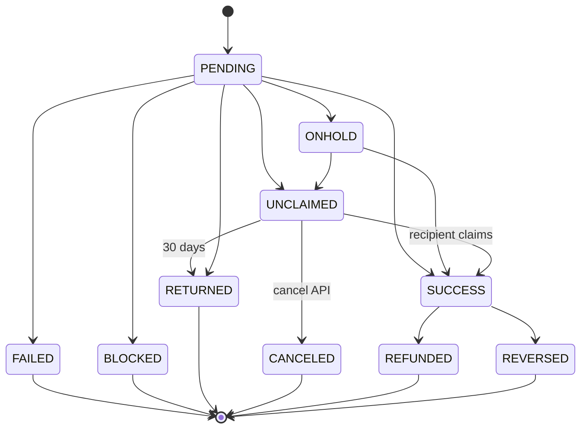

# Architecture

Neighborline is a pnpm monorepo of TypeScript ESM packages (strict mode). The authoritative domain contract is
[`packages/core/src/schemas.ts`](../packages/core/src/schemas.ts). Money is integer cents everywhere and becomes a
`"150.00"` string only at the PayPal boundary.

## Processes

Money can leave only through one process. Everything else, including every AI call, runs where there is no Payouts
client and no Payouts credential.



| Process | Holds | Can | Cannot |
|---|---|---|---|
| `apps/web` | Main PayPal app keys (Orders, Subscriptions, webhooks, Transaction Search), model keys, `DATABASE_URL`, the approver HMAC key | Run intake and the AI agents, record approvals and passkey signatures, settle webhooks, serve every page | Construct a Payouts client, create a payout batch (one exception: seeding fictional demo history, which never calls PayPal), read `PAYPAL_PAYOUTS_*` (all three fail the build: [`least-privilege.test.ts`](../apps/web/lib/server/least-privilege.test.ts)) |
| `apps/approver` | Payouts app keys, `DATABASE_URL`, the approver HMAC key | Execute an approval record, poll a batch, cancel an unclaimed item, verify a Payouts-app webhook, record a manual hand-over for a batch PayPal refused (moves no money) | Trust anything in the request beyond "look at approval X" (see below) |
| `tools/dev-db` (local only) | An in-memory PGlite | Serve it over the Postgres wire protocol on loopback so web and approver share one database in `pnpm dev` and e2e | Start in production (it refuses) |

**What the approver checks before it pays** ([`apps/approver/src/approver.ts`](../apps/approver/src/approver.ts)):

1. The payload it was sent is canonical (`core.approvalPayload`) and hashes to the claimed hash, which equals the hash
   on the stored approval record.
2. The record is `complete` with ≥ max(2, `group.requiredApprovals`) **distinct current organizers**, and the approver
   list in the request matches the record.
3. **Every** counted approver has a stored assertion that verifies against that organizer's public key, that hash
   and the server nonce stored with it ([`assertions.ts`](../apps/approver/src/assertions.ts)). There is no unsigned
   mode. Demo keys count only in `DEMO_MODE` (never with live PayPal); a demo-visitor passkey (`bound_to
   demo-visitor:<tag>`) counts only in `DEMO_MODE` and only when every request is that visitor's own demo run
   (`req_demo_<tag>_…`).
4. The content rebuilt from the request rows it reads itself hashes to the same value (amounts and destinations come
   from the database, never from the web request).
5. `core.computeAmount` and `core.checkRail`, re-run on the policy, history, today's spend and official handles it
   reads itself ([`recheck.ts`](../apps/approver/src/recheck.ts)), still allow every approved amount and raise no
   block flag.
6. `db.createBatch` re-checks `canExecute` under row locks and is idempotent per approval; `sender_batch_id` derives
   from the approval id and hash. Steps 1–5 run again before **every** send, including a re-send of a batch left
   `UNKNOWN` by a timeout (see [PAYPAL.md](PAYPAL.md#when-the-create-call-fails-definite-vs-ambiguous)). Refusals,
   ambiguous outcomes and executions are appended to the hash-chained audit log (`approver.execute_refused`,
   `approver.paypal_unknown`, `approver.executed`).

**Payout rails** ([`rails.ts`](../apps/approver/src/rails.ts)). The batch goes out on a `PayoutRail`:

| Rail | Moves money | Used when | Authority |
|---|---|---|---|
| `paypal_payouts` (primary) | Yes, PayPal Payouts from the sponsor's account | Always first | Steps 1–6 above |
| `manual` (fallback) | **No.** It records an organizer's attestation (cash, check, other + receipt note) | Only for a batch PayPal refused at the account level (`FAILED_RAIL`), only when the group turned on "if PayPal is unavailable or the account is restricted, switch to manual recording" | Steps 2–5 re-run on the stored approval ([`verify.ts`](../apps/approver/src/verify.ts)), the recorder must be a signed-in organizer of the group, a receipt note is required ([`manual.ts`](../apps/approver/src/manual.ts)) |

An account-level refusal (`SENDER_RESTRICTED`, `SENDER_LOCKED`, `AUTHORIZATION_ERROR`, `REQUIRED_SCOPE_MISSING`,
`CIP_NOT_VERIFIED`, `SENDER_EMAIL_UNCONFIRMED`, `NOT_AUTHORIZED`, any 401/403) marks the batch `FAILED_RAIL`: certainly
nothing was sent, unlike an ambiguous error (`UNKNOWN`). The web app raises a `rail_unavailable` organizer alert
([`engine/rail.ts`](../apps/web/lib/server/engine/rail.ts)). Organizers can retry once PayPal clears the account (the
same `sender_batch_id`, after a compare-and-set FAILED_RAIL → CREATING) or record the hand-over (FAILED_RAIL → MANUAL,
items SUCCESS with actor `manual-rail:<organizer>`, audit `approver.manual_recorded`); whichever claims the batch first
wins. Reconcile skips manual items; the ledger and report label them "by hand".

Requests are HMAC-signed with a per-deployment secret, timestamped (±120 s) and carry a nonce the approver accepts once
([`protocol.ts`](../apps/approver/src/protocol.ts)). In production the approver runs as a separate process in the web
instance with its own environment, or as its own Render private service; see [DEPLOY.md](DEPLOY.md#approver-process).

## Package boundaries



| Package | Owns | Must not |
|---|---|---|
| `packages/core` | zod schemas, policy validation, `computeAmount`, rail checks (handles, injection, history), approval hashing, request and payout-item state machines, i18n catalog, transparency report math, PII redaction | Do I/O. It depends only on `zod` |
| `packages/db` | Drizzle schema, migrations (SQL files embedded into `migrations.generated.ts`), repositories that enforce state transitions and write the audit log | Call PayPal or models |
| `packages/agents` | Provider abstraction (Anthropic, OpenAI, fixtures), the structured-output pipeline, IntakeAgent, PolicyCompiler, NotifyAgent, ReportWriter | Compute amounts, decide eligibility, depend on `@neighborline/paypal` (tested) |
| `packages/paypal` | Typed PayPal REST client, idempotency, webhook verification and parsing, item state machine copy, reconcile, approval tokens, `neighborline-payouts-mcp` | Depend on private packages at runtime (core is a dev dependency, used by a drift test) |
| `packages/passkeys` | WebAuthn challenge = SHA-256(domain ‖ approval hash ‖ single-use server nonce) (`challengeFor`), verification shared by web and approver, labelled demo software authenticator | Hold PayPal keys |
| `apps/approver` | The only Payouts client in the running system; execute / poll / cancel-unclaimed / verify-webhook | Accept amounts, destinations or approvers from its caller |
| `apps/web` | Pages, route handlers, SSE stream, `/api/internal/*`. Everything goes through one interface, `Services`, in [`lib/server/services.ts`](../apps/web/lib/server/services.ts) | Put domain logic in components; import anything but `@neighborline/approver/protocol` from the approver |
| `tools/fake-paypal`, `tools/dev-db` | Local stand-ins for PayPal and Postgres | Ship to production |

### Runtime modes

| Variable | Values | Effect |
|---|---|---|
| `PAYPAL_MODE` | `fake` (default), `sandbox`, `live` | `resolvePayPalEnv()` picks `FAKE_PAYPAL_URL`, the sandbox or the live base URL ([`paypal.ts`](../packages/paypal/src/paypal.ts)). Outside `fake`, the approver requires `PAYPAL_PAYOUTS_CLIENT_ID/SECRET` |
| `AI_MODE` | `fixture` (default), `live` | `createProviders()` picks fixture or real providers ([`create.ts`](../packages/agents/src/providers/create.ts)) |
| `DATABASE_URL` | empty or a Postgres URL | `pnpm dev` and e2e set it to `tools/dev-db`; production uses Render Postgres. Without it the web app alone uses an in-process PGlite (tests) |
| `DEMO_MODE` | empty, `true`, `false` | **Fails closed**: empty means on only with `PAYPAL_MODE=fake`; never on with `live` (the approver refuses to start). On: `/api/demo/play`, labelled demo keys (Dana scripted; a browser may sign only as Marcus and only on its own runs), demo-visitor passkeys, `req_demo_*` rehearsals excluded from caps. Off: none of that; every approval needs an organizer's passkey |
| `NEIGHBORLINE_SESSION_SECRET` | ≥ 32 chars | Signs organizer session cookies and visitor cookies. Unset: random per process. (Invite codes are random, single use and stored hashed in `organizer_invites`) |
| `RATE_LIMITS`, `TRUST_PROXY_HOPS` | `on`/`off`, `1` | In-memory token buckets per IP, per visitor and global for live AI; which `X-Forwarded-For` entry is the client |
| `AUDIO_RETENTION` | `none` (default), `24h` | What happens to raw voice recordings after transcription |

## Data model

All tables are in [`packages/db/src/schema.ts`](../packages/db/src/schema.ts). JSON columns hold zod-validated core
types. Timestamps are `timestamptz`.

| Table | Key columns | Notes |
|---|---|---|
| `groups` | `id`, `slug`, `official_handles`, `fiscal_sponsor`, `active_policy_id`, `timezone`, `required_approvals` (default 2) | Official handles feed rail protection. `timezone` sets the daily-budget boundary |
| `organizers` | `id`, `group_id`, `handles`, `lang` | `handles` are the organizer's own accounts, used to block self-payment and lookalikes |
| `policies` | `id`, `group_id`, `version`, `body`, `status` | Unique `(group_id, version)`. A partial unique index allows one `active` policy per group |
| `requests` | `status`, `extracted`, `payout_destination`, `destination_key`, `phone_key`, `computed`, `amount_cents`, `rail_flags` | `destination_key` and `phone_key` are normalized for household and velocity lookups |
| `approvals` | `request_ids`, `total_cents`, `policy_version_id`, `hash`, `status` | Partial unique index: one live (non-void) approval per hash |
| `approval_signatures` | PK `(approval_id, organizer_id)` | "Two distinct organizers" is a database guarantee |
| `payout_batches` | `approval_id` (unique), `sender_batch_id` (unique), `paypal_batch_id` (unique) | One batch per approval |
| `payout_items` | `sender_item_id` (unique), `paypal_item_id` (unique), `status`, `transaction_id`, `was_unclaimed`, `success_at` | `was_unclaimed` and `success_at` feed the report |
| `donations` | `paypal_order_id` (unique), `transaction_id` (unique), `donor_key` | `donor_key` is an opaque non-PII key for distinct-donor counts |
| `webhook_events` | PK = PayPal event id, `verified`, `raw` | The PK is the dedupe key |
| `notifications` | `request_id`, `lang`, `message_key`, `text`, `status` | What was said to the neighbor, in which language |
| `organizer_credentials`, `approval_assertions` | credential id, public key (COSE), kind `passkey`/`demo_key`; assertion per (approval hash, organizer) | The approver re-verifies the stored assertion with the stored public key before paying |
| `audit_log` | `seq`, `actor`, `action`, `entity_*`, `data`, `prev_hash`, `row_hash` | Hash-chained. A trigger rejects UPDATE, DELETE and TRUNCATE ([migration](../packages/db/drizzle/0001_audit_append_only.sql)). Also the durable store for background-job records (`reconcile.window`, `unclaimed.renotify`, `organizer.alert`, `report.generated`), approver decisions and `audio.deleted` |

## State machines

### Help request

Source: `REQUEST_TRANSITIONS` in [`core/src/state.ts`](../packages/core/src/state.ts). The db enforces it in
`updateRequest` and audits every status change.



(Every open state can also move to `cancelled`; `intake` and `needs_clarification` can move to `declined`;
`returned` and `failed` can move to `needs_clarification`. The diagram omits some edges for readability.)

### Payout item

Source: `ITEM_TRANSITIONS` and `applyItemEvent` in [`core/src/state.ts`](../packages/core/src/state.ts), mirrored in
[`paypal/src/payout-status.ts`](../packages/paypal/src/payout-status.ts) and kept identical by
[`core-compat.test.ts`](../packages/paypal/src/core-compat.test.ts).



`applyItemEvent(current, incoming)` returns `changed: false` for a duplicate and for a stale event (one that is not
an allowed forward move), so webhooks can arrive late, twice, or out of order. Webhook event types map to statuses
with `itemStatusForWebhookEvent` (`DENIED → FAILED`, `HELD → ONHOLD`).

## Idempotency design

The rule is that **one two-person approval can produce at most one PayPal batch**, however many times anyone taps,
retries or times out.

### 1. The approval hash pins the content

[`approvalPayload`](../packages/core/src/approvals.ts) builds this object, which `canonicalJson` serializes with
sorted keys and `approvalHash` hashes with SHA-256 (a pure-JS implementation tested against NIST vectors and
`node:crypto`):

```ts
{
  v: 1,
  policyVersionId,                        // the policy version that computed the amounts
  requestIds: [...sorted],
  items: [                                // sorted by requestId
    { requestId, amountCents, wallet, recipientType, receiver /* normalized */ },
  ],
  totalCents,
}
```

Change one cent, one receiver, the wallet, the policy version or the set of requests, and the hash changes.

### 2. The ids PayPal sees derive from the approval record

```ts
senderBatchIdFor(approval) = 'nl_'  + sha256(`neighborline/paypal/sender_batch_id/v2\n${approval.id}\n${approval.hash}`).slice(0, 24)   // 27 chars
senderItemIdFor(approval, r) = 'nli_' + sha256(`neighborline/paypal/sender_item_id/v2\n${approval.id}\n${approval.hash}\n${r}`).slice(0, 24)
```

PayPal refuses a reused `sender_batch_id` for 30 days, so the same approval cannot be paid twice even if our own
database lost track of it. The approval **id** is in the preimage so a later, legitimate approval of identical
content (a re-payment after `RETURNED` or a cancelled unclaimed item) gets a new id; only *open* approvals
(pending/complete) are unique per hash (`approvals_open_hash_uq`), so double taps still land on one record. The
domain tag keeps the id from ever equalling another hash of the same fields.

### 3. Each layer dedupes

| Layer | Mechanism | Code |
|---|---|---|
| Organizer double tap | Same organizer twice is `ok, changed: false` | `addApprover` in [`core/src/approvals.ts`](../packages/core/src/approvals.ts) |
| Concurrent approvals | Approval row locked `FOR UPDATE`; signature PK `(approval_id, organizer_id)` | `addApproverTx` in [`db/src/repo/approvals.ts`](../packages/db/src/repo/approvals.ts) |
| Same requests, new approval | `createOrGetApproval` returns the live approval for the hash (partial unique index) | [`db/src/repo/approvals.ts`](../packages/db/src/repo/approvals.ts) |
| Content changed between signatures | Content is recomputed from locked rows; a mismatch voids the approval | `addApproverTx`, `createBatch` |
| Executing twice | `payout_batches.approval_id` is unique; `createBatch` returns the existing batch | `createBatch` in [`db/src/repo/payouts.ts`](../packages/db/src/repo/payouts.ts) |
| HTTP retry to PayPal | `PayPal-Request-Id = sender_batch_id`; retries only on 429/5xx; network errors replayed only with that key | [`paypal/src/payouts.ts`](../packages/paypal/src/payouts.ts), [`paypal/src/retry.ts`](../packages/paypal/src/retry.ts) |
| PayPal says "already used" | Find `/v1/payments/payouts/{id}` in any link of the error body, GET it, return `duplicate: true`; else `DuplicateBatchError` | `createBatch`, `findExistingBatchId` |
| Concurrent taps that lose a race | Re-read and re-run against the fresh state (the request moved on to approved/paying): every tap returns 200 with the same batch | `ApprovalService.approve` in [`web/lib/server/approval-service.ts`](../apps/web/lib/server/approval-service.ts) |
| Ambiguous create (timeout, 5xx) | Batch `UNKNOWN`, never `FAILED`; re-sent with the same `sender_batch_id` after a fresh policy re-check | [`approver/src/approver.ts`](../apps/approver/src/approver.ts) |
| Duplicate webhook | `webhook_events` PK on the PayPal event id; `beginWebhookEvent` → `new`/`retry`/`done`, `processed_at` set only after the apply (at least once) | `beginWebhookEvent` in [`db/src/repo/misc.ts`](../packages/db/src/repo/misc.ts) |
| Out-of-order webhook | Monotonic item state machine | `applyItemEvent` / `upsertItemFromEvent` |
| Donation capture double tap | `PayPal-Request-Id: capture-{orderId}`; `ORDER_ALREADY_CAPTURED` returns the existing capture | [`paypal/src/orders.ts`](../packages/paypal/src/orders.ts) |

## Request flow

1. **Intake** (web). `agents.intake.fromAudio` or `fromText` → store `originalText`, `englishText`, `extraction`. The raw
   recording is wiped right after transcription (`AUDIO_RETENTION=none`).
2. **Confirm** (web). `getActivePolicy` → `getHistoryForDestination` → `getTodaySpentCents` → core `computeAmount` and
   `checkRail({ text: [originalText, englishText] })` → `updateRequest(status: 'awaiting_approval')`.
3. **Approve** (web). `POST /api/approvals/challenge` issues `challengeFor(approvalHash, serverNonce)` (single use,
   5 min). Each organizer signs it (passkey, or a labelled demo key in `DEMO_MODE`) → the nonce is consumed and
   stored with the assertion (`recordApprovalAssertion`) → `createOrGetApproval` (refuses block flags) → `addApproverTx`.
4. **Execute** (approver). When the record is complete, the web app sends `POST /v1/execute`. The approver runs the six
   checks above, then `createBatch` → `PayoutsApi.createBatch({ senderBatchId, items[] })` → `updateBatch`,
   `setPaypalItemId` → audit `approver.executed`.
5. **Webhook** (web). `verifyWebhookSignature` (raw body; payout events for the Payouts app are verified by the
   approver) → `beginWebhookEvent` (skip only events already processed) → `itemStatusForWebhookEvent` → `upsertItemFromEvent` → if
   changed, `notifyKeyFor` → `agents.notify.render` → `recordNotification` → `markWebhookProcessed`.
6. **Reconcile and follow-ups** (web, triggered by Render Workflows over signed `/api/internal/*`).
   `paypal.reporting.searchTransactions` → `reconcile(localItems, txns)` (amount, currency and status drift) →
   `saveReconcileRun` (shown on `/ledger`); unclaimed sweeps and claim-help nudges; organizer alerts; report versions.

## Live events

The `/demo` stage and organizer phones subscribe to `GET /api/stream` (Server-Sent Events). Messages are
`StageEvent`s from core (`request.created`, `request.readback`, `approval.added`, `payout.batch_created`,
`payout.item_updated`, `webhook.verified`, `notify.sent`, …). `?requestId=` replays that request's history first, so
a late subscriber never misses `request.created`. A `reset` message tells a stage the demo database was reset under
its run.

## Who sees what (web)

Every browser gets an HMAC-signed `nl_visitor` cookie the first time it creates something; its 12-hex *tag* is
built into what it creates (`req_demo_<tag>_…` for `/demo` runs, `req_v_<tag>_…` for `/call`), so ownership is
stateless ([`security/visitor.ts`](../apps/web/lib/server/security/visitor.ts)).

| Reader | `/api/requests`, `/api/requests/:id`, `/api/stream`, `/organizer` | Thread, text, audio, confirm |
|---|---|---|
| Signed-in organizer (live passkey session) | Everything | Everything |
| The visitor who started it | Full | Allowed |
| Anyone else | Redacted: first name + area, masked destination, category, amount and rule, approval progress; no transcript, phone, address, appeal text or message text ([`security/redact.ts`](../apps/web/lib/server/security/redact.ts)). In `DEMO_MODE`, another visitor's runs are not listed at all (404) | 404 |

Every non-GET API call passes [`security/guard.ts`](../apps/web/lib/server/security/guard.ts): same-origin
(`Sec-Fetch-Site`/`Origin`; PayPal webhooks and HMAC-signed internal jobs are exempt), `application/json` only for
JSON routes (415), bodies capped at 64 KB (uploads: `Content-Length` required, 2 minutes / 4 MB of audio). Intake,
live-AI calls, approvals, passkey ceremonies, demo runs and reconcile are rate-limited
([`security/rate-limit.ts`](../apps/web/lib/server/security/rate-limit.ts)). `middleware.ts` sets a nonce-based
CSP with `strict-dynamic` (PayPal and Venmo hosts allowed for the JS SDK), `frame-ancestors 'none'`, HSTS in
production, `nosniff`, `Referrer-Policy` and a `Permissions-Policy` that allows only the microphone and passkeys.
