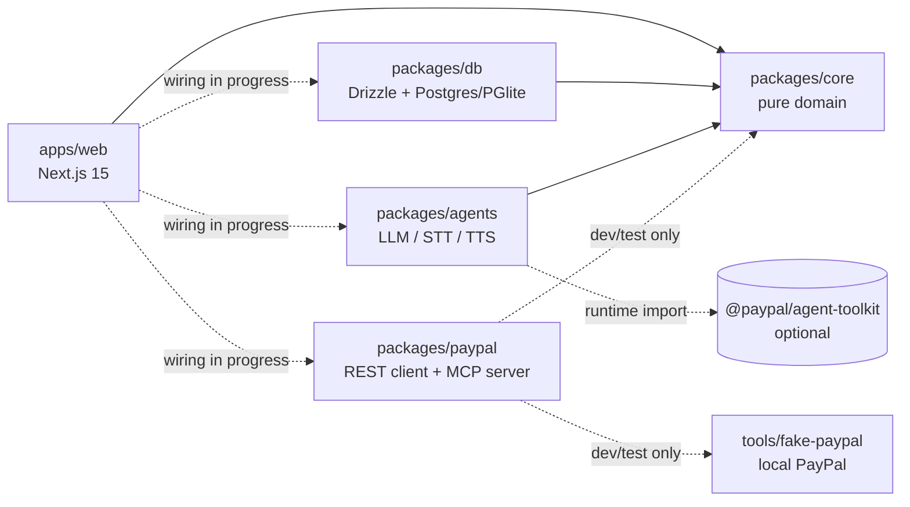
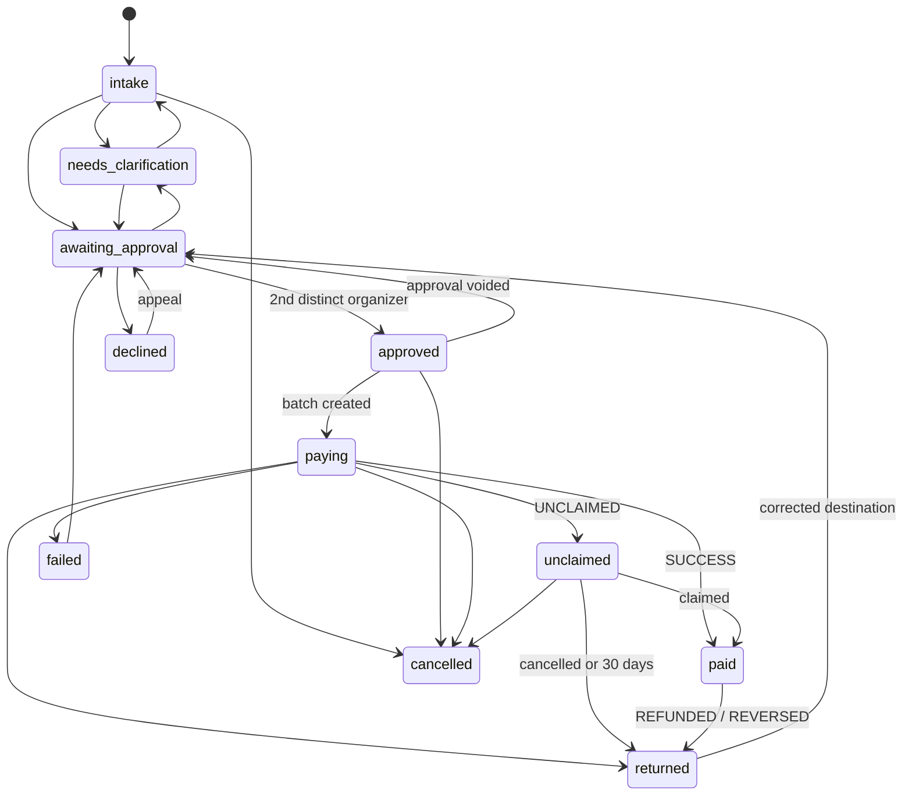
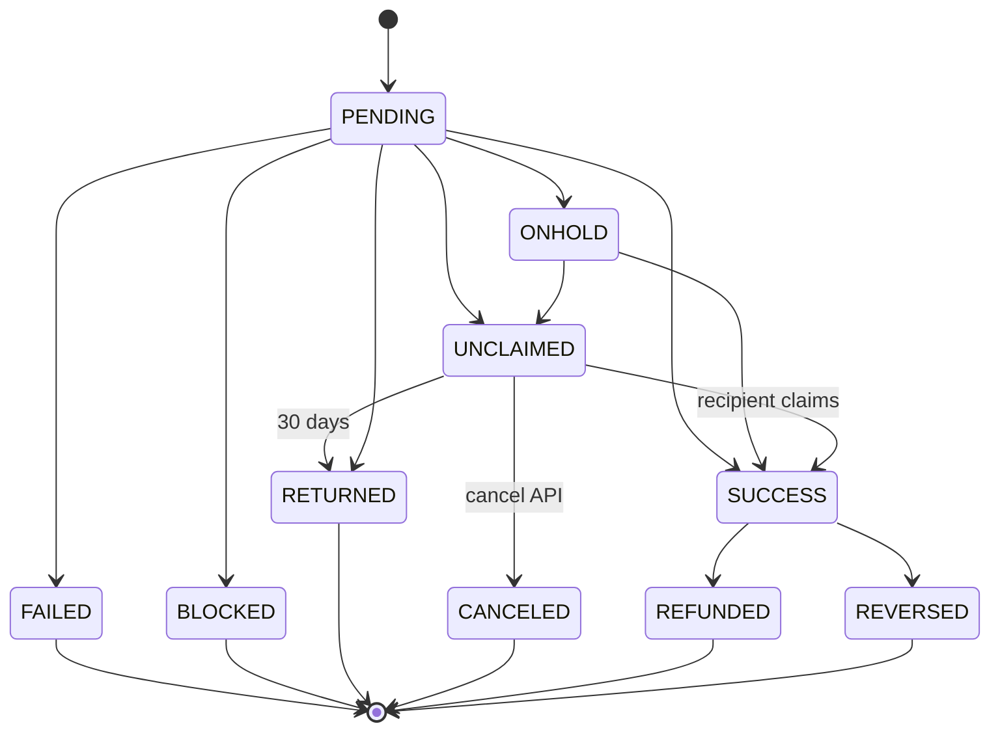

# Architecture

Neighborline is a pnpm monorepo of TypeScript ESM packages (strict mode). The authoritative domain contract is
[`packages/core/src/schemas.ts`](../packages/core/src/schemas.ts). Money is integer cents everywhere and becomes a
`"150.00"` string only at the PayPal boundary.

## Package boundaries



| Package | Owns | Must not |
|---|---|---|
| `packages/core` | zod schemas, policy validation, `computeAmount`, rail checks (handles, injection, history), approval hashing, request and payout-item state machines, i18n catalog, transparency report math | Do I/O. It depends only on `zod` |
| `packages/db` | Drizzle schema, migrations (SQL files embedded into `migrations.generated.ts`), repositories that enforce state transitions and write the audit log | Call PayPal or models |
| `packages/agents` | Provider abstraction (Anthropic, OpenAI, fixtures), the structured-output pipeline, IntakeAgent, PolicyCompiler, NotifyAgent, ReportWriter | Compute amounts, decide eligibility, hold PayPal Payouts credentials |
| `packages/paypal` | Typed PayPal REST client, idempotency, webhook verification and parsing, item state machine copy, reconcile, approval tokens, `neighborline-payouts-mcp` | Depend on private packages at runtime (core is a dev dependency, used by a drift test) |
| `tools/fake-paypal` | An HTTP fake of the PayPal subset we use, with deterministic outcomes and signed webhooks | Ship to production |
| `apps/web` | Pages, route handlers, SSE stream. Everything goes through one interface, `Services`, in [`lib/server/services.ts`](../apps/web/lib/server/services.ts) | Put domain logic in components |

**Integration status (Oct 16, 2026).** `createServices()` returns `MockEngine`, an in-memory implementation that
emits the same events as the real one. The mapping from each `Services` method to the real packages is in
[`apps/web/INTEGRATION.md`](../apps/web/INTEGRATION.md), and that wiring is in progress.

### Runtime modes

| Variable | Values | Effect |
|---|---|---|
| `PAYPAL_MODE` | `fake` (default), `sandbox`, `live` | `createPayPalFromEnv()` picks `FAKE_PAYPAL_URL`, the sandbox or the live base URL ([`paypal.ts`](../packages/paypal/src/paypal.ts)) |
| `AI_MODE` | `fixture` (default), `live` | `createProviders()` picks fixture or real providers ([`create.ts`](../packages/agents/src/providers/create.ts)) |
| `DATABASE_URL` | empty or a Postgres URL | Empty means embedded PGlite at `./.pglite` |
| `DEMO_MODE` | `true` / `false` | `false` disables `/api/demo/*` |

## Data model

All tables are in [`packages/db/src/schema.ts`](../packages/db/src/schema.ts). JSON columns hold zod-validated core
types. Timestamps are `timestamptz`.

| Table | Key columns | Notes |
|---|---|---|
| `groups` | `id`, `slug`, `official_handles`, `fiscal_sponsor`, `active_policy_id`, `timezone`, `required_approvals` (default 2) | Official handles feed rail protection. `timezone` sets the daily-budget boundary |
| `organizers` | `id`, `group_id`, `handles`, `lang` | `handles` are the organizer's own accounts, used to block self-payment and lookalikes |
| `policies` | `id`, `group_id`, `version`, `body`, `status` | Unique `(group_id, version)`. A partial unique index allows one `active` policy per group |
| `requests` | `status`, `extracted`, `payout_destination`, `destination_key`, `phone_key`, `computed`, `amount_cents`, `rail_flags` | `destination_key` and `phone_key` are normalized for household and velocity lookups |
| `approvals` | `request_ids`, `total_cents`, `policy_version_id`, `hash`, `status` | Partial unique index: one live (non-void) approval per hash |
| `approval_signatures` | PK `(approval_id, organizer_id)` | "Two distinct organizers" is a database guarantee |
| `payout_batches` | `approval_id` (unique), `sender_batch_id` (unique), `paypal_batch_id` (unique) | One batch per approval |
| `payout_items` | `sender_item_id` (unique), `paypal_item_id` (unique), `status`, `transaction_id`, `was_unclaimed`, `success_at` | `was_unclaimed` and `success_at` feed the report |
| `donations` | `paypal_order_id` (unique), `transaction_id` (unique), `donor_key` | `donor_key` is an opaque non-PII key for distinct-donor counts |
| `webhook_events` | PK = PayPal event id, `verified`, `raw` | The PK is the dedupe key |
| `notifications` | `request_id`, `lang`, `message_key`, `text`, `status` | What was said to the neighbor, in which language |
| `audit_log` | `seq`, `actor`, `action`, `entity_*`, `data`, `prev_hash`, `row_hash` | Hash-chained. A trigger rejects UPDATE, DELETE and TRUNCATE ([migration](../packages/db/drizzle/0001_audit_append_only.sql)) |

## State machines

### Help request

Source: `REQUEST_TRANSITIONS` in [`core/src/state.ts`](../packages/core/src/state.ts). The db enforces it in
`updateRequest` and audits every status change.



(Every open state can also move to `cancelled`; `intake` and `needs_clarification` can move to `declined`;
`returned` and `failed` can move to `needs_clarification`. The diagram omits some edges for readability.)

### Payout item

Source: `ITEM_TRANSITIONS` and `applyItemEvent` in [`core/src/state.ts`](../packages/core/src/state.ts), mirrored in
[`paypal/src/payout-status.ts`](../packages/paypal/src/payout-status.ts) and kept identical by
[`core-compat.test.ts`](../packages/paypal/src/core-compat.test.ts).



`applyItemEvent(current, incoming)` returns `changed: false` for a duplicate and for a stale event (one that is not
an allowed forward move), so webhooks can arrive late, twice, or out of order. Webhook event types map to statuses
with `itemStatusForWebhookEvent` (`DENIED → FAILED`, `HELD → ONHOLD`).

## Idempotency design

The rule is that **one two-person approval can produce at most one PayPal batch**, however many times anyone taps,
retries or times out.

### 1. The approval hash pins the content

[`approvalPayload`](../packages/core/src/approvals.ts) builds this object, which `canonicalJson` serializes with
sorted keys and `approvalHash` hashes with SHA-256 (a pure-JS implementation tested against NIST vectors and
`node:crypto`):

```ts
{
  v: 1,
  policyVersionId,                        // the policy version that computed the amounts
  requestIds: [...sorted],
  items: [                                // sorted by requestId
    { requestId, amountCents, wallet, recipientType, receiver /* normalized */ },
  ],
  totalCents,
}
```

Change one cent, one receiver, the wallet, the policy version or the set of requests, and the hash changes.

### 2. The ids PayPal sees derive from the hash

```ts
senderBatchIdFor(approval) = 'nl_'  + approval.hash.slice(0, 24)                          // 27 chars
senderItemIdFor(approval, requestId) = 'nli_' + sha256(`${approval.hash}:${requestId}`).slice(0, 24)  // 28 chars, ≤ 63
```

PayPal refuses a reused `sender_batch_id` for 30 days, so the same approval cannot be paid twice even if our own
database lost track of it.

### 3. Each layer dedupes

| Layer | Mechanism | Code |
|---|---|---|
| Organizer double tap | Same organizer twice is `ok, changed: false` | `addApprover` in [`core/src/approvals.ts`](../packages/core/src/approvals.ts) |
| Concurrent approvals | Approval row locked `FOR UPDATE`; signature PK `(approval_id, organizer_id)` | `addApproverTx` in [`db/src/repo/approvals.ts`](../packages/db/src/repo/approvals.ts) |
| Same requests, new approval | `createOrGetApproval` returns the live approval for the hash (partial unique index) | [`db/src/repo/approvals.ts`](../packages/db/src/repo/approvals.ts) |
| Content changed between signatures | Content is recomputed from locked rows; a mismatch voids the approval | `addApproverTx`, `createBatch` |
| Executing twice | `payout_batches.approval_id` is unique; `createBatch` returns the existing batch | `createBatch` in [`db/src/repo/payouts.ts`](../packages/db/src/repo/payouts.ts) |
| HTTP retry to PayPal | `PayPal-Request-Id = sender_batch_id`; retries only on 429/5xx; network errors replayed only with that key | [`paypal/src/payouts.ts`](../packages/paypal/src/payouts.ts), [`paypal/src/retry.ts`](../packages/paypal/src/retry.ts) |
| PayPal says "already used" | Find `/v1/payments/payouts/{id}` in any link of the error body, GET it, return `duplicate: true`; else `DuplicateBatchError` | `createBatch`, `findExistingBatchId` |
| Duplicate webhook | `webhook_events` PK on the PayPal event id | `recordWebhookEvent` in [`db/src/repo/misc.ts`](../packages/db/src/repo/misc.ts) |
| Out-of-order webhook | Monotonic item state machine | `applyItemEvent` / `upsertItemFromEvent` |
| Donation capture double tap | `PayPal-Request-Id: capture-{orderId}`; `ORDER_ALREADY_CAPTURED` returns the existing capture | [`paypal/src/orders.ts`](../packages/paypal/src/orders.ts) |

## Request flow (intended server wiring)

From [`NOTES-core.md`](../NOTES-core.md) and [`apps/web/INTEGRATION.md`](../apps/web/INTEGRATION.md):

1. **Intake.** `agents.intake.fromAudio` or `fromText` → store `originalText`, `englishText`, `extraction`.
2. **Confirm.** `getActivePolicy` → `getHistoryForDestination` → `getTodaySpentCents` → core `computeAmount` and
   `checkRail({ text: [originalText, englishText] })` → `updateRequest(status: 'awaiting_approval')`.
3. **Approve.** `createOrGetApproval` (refuses block flags) → `addApproverTx` → when complete, `createBatch` →
   `paypal.payouts.createBatch({ senderBatchId, items[] })` → `updateBatch`, `setPaypalItemId`.
4. **Webhook.** `verifyWebhookSignature` (raw body) → `recordWebhookEvent` (skip duplicates) →
   `itemStatusForWebhookEvent` → `upsertItemFromEvent` → if changed, `notifyKeyFor` → `agents.notify.render` →
   `recordNotification`.
5. **Reconcile.** `paypal.reporting.searchTransactions` → `reconcile(localItems, txns)`.

## Live events

The `/demo` stage and organizer phones subscribe to `GET /api/stream` (Server-Sent Events). Messages are
`StageEvent`s from core (`request.created`, `request.readback`, `approval.added`, `payout.batch_created`,
`payout.item_updated`, `webhook.verified`, `notify.sent`, …). `?requestId=` replays that request's history first, so
a late subscriber never misses `request.created`.
