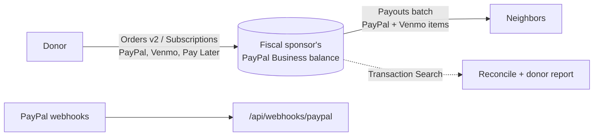

# PayPal deep dive

This is how Neighborline uses PayPal, and why. The line-by-line API cheat sheet with every source is
[`packages/paypal/PAYPAL_NOTES.md`](../packages/paypal/PAYPAL_NOTES.md) (verified Oct 16, 2026). Facts marked
**[obs]** there are observed sandbox behavior rather than documented behavior; the code treats them defensively.

Base URLs: sandbox `https://api-m.sandbox.paypal.com`, live `https://api-m.paypal.com`. Local development uses
[`tools/fake-paypal`](../tools/fake-paypal) at `http://localhost:4010`.

## Money flows

## 1. Payouts (the core of the product)

Client: [`packages/paypal/src/payouts.ts`](../packages/paypal/src/payouts.ts).

### Creating a batch: `POST /v1/payments/payouts`

What we send, per item:

| Field | Our value | Why |
|---|---|---|
| `sender_batch_header.sender_batch_id` | `nl_` + first 24 hex chars of the approval hash | Deterministic, so a retry can never create a second batch ([ARCHITECTURE.md](ARCHITECTURE.md#idempotency-design)) |
| `recipient_type` | `EMAIL`, `PHONE` or `USER_HANDLE` | `USER_HANDLE` is a Venmo username. The client rejects `USER_HANDLE` with `recipient_wallet: PAYPAL` |
| `recipient_wallet` | `PAYPAL` or `VENMO` | One batch can mix both |
| `amount` | `{ value: "150.00", currency: "USD" }` from integer cents | Floats are rejected, never rounded ([`money.ts`](../packages/paypal/src/money.ts)) |
| `sender_item_id` | `nli_` + 24 hex chars | ≤ 63 chars; echoed in webhooks and reports |
| `note` | Required for Venmo | PayPal: "A message must be included for each recipient" on Venmo. ≤ 4000 ASCII or ≤ 1000 non-ASCII characters, checked locally |
| `application_context.social_feed_privacy` | Always `PRIVATE` for Venmo | Aid never appears in a public Venmo feed. Sent explicitly even though it is the default |
| `purpose` | Set explicitly, validated against `AWARDS, PRIZES, DONATIONS, GOODS, SERVICES, REBATES, CASHBACK, DISCOUNTS, NON_GOODS_OR_SERVICES` | PayPal's default in the Payouts Web UI is `GOODS`; mutual aid is not a sale. The payments lane suggests `NON_GOODS_OR_SERVICES`, the stage shows `DONATIONS`: see [open questions](#open-questions) |
| `notification_language` | e.g. `es-US` | Language of PayPal's claim email for recipients without an account |

Local validation happens before anything is sent (`buildPayoutRequest` throws `PayPalInputError`): 1–15,000 items,
one currency per call, unique `sender_item_id`s, field lengths.

Other documented limits: 400 POSTs per minute (`429 RATE_LIMIT_REACHED`), and **sandbox rejects
`recipient_type: PHONE`**.

### Idempotency, three layers

1. **`sender_batch_id`.** PayPal refuses a reused id for 30 days and completes a payment only once per id.
2. **`PayPal-Request-Id = sender_batch_id`.** A repeated request with the same key returns the latest state of the
   original payout. PayPal keeps the key for 30 days on payouts.
3. **Duplicate resolution.** The duplicate error's name is undocumented. **[obs]** Sandbox returns
   `400 USER_BUSINESS_ERROR` with a `details[].link` (singular) to the original batch. So:
   - `isDuplicateSenderBatchError()` matches on the issue text or field, not the error name.
   - `findExistingBatchId()` scans every link array in the error body for `/v1/payments/payouts/{id}`.
   - `createBatch` GETs that batch and returns it with `duplicate: true`.
   - With no link it throws `DuplicateBatchError`, and the caller uses its stored `paypal_batch_id`. PayPal has no
     search-by-`sender_batch_id` endpoint, so we persist the mapping.

Sources: [customize](https://developer.paypal.com/api/payouts/customize.md),
[payouts-post](https://developer.paypal.com/api/payments.payouts-batch/v1/payouts-post).

### Reading status

| Call | Use |
|---|---|
| `GET /v1/payments/payouts/{payout_batch_id}?page&page_size&total_required` | Batch plus items. `listAllItems` follows pagination (`page_size` up to 1000) |
| `GET /v1/payments/payouts-item/{payout_item_id}` | One item, including `errors.name` such as `RECEIVER_UNREGISTERED`. Webhooks never carry error objects, so this is how we learn *why* |
| `POST /v1/payments/payouts-item/{payout_item_id}/cancel` | Only on `UNCLAIMED`; the item becomes `RETURNED` and a `PAYMENT.PAYOUTS-ITEM.CANCELED` webhook follows |

### Item statuses and what the neighbor sees

| PayPal `transaction_status` | Our request status | Message to the neighbor |
|---|---|---|
| `PENDING`, `ONHOLD` | `paying` | none |
| `SUCCESS` | `paid` | `paid`: "$150 has been sent to your Venmo" |
| `UNCLAIMED` | `unclaimed` | `unclaimed_help`: how to claim with the same email or phone |
| `RETURNED`, `REFUNDED`, `REVERSED` | `returned` | organizer follow-up |
| `FAILED` (incl. `DENIED`), `BLOCKED` | `failed` | organizer follow-up |
| `CANCELED` | `cancelled` | none |

Unclaimed items return automatically after 30 days. Sources:
[item status](https://developer.paypal.com/payouts/use-payouts/track-payout-item-status.md),
[OpenAPI](https://docs.paypal.ai/api-reference/payments_payouts_batch_v1.json).

### Venmo specifics

- `recipient_wallet: "VENMO"`; recipients can be a US mobile number, an email or a Venmo username. US only.
- A note is required. The sandbox test value `ERRPYO013` in `sender_batch_id` simulates the "note missing" error.
- `POSPYO003` in `items[0].note` simulates a 201 for Venmo. **Whether a real sandbox Venmo payout settles is not
  documented**, and we have not verified it yet.

Sources: [Venmo payouts](https://developer.paypal.com/payouts/use-payouts/venmo.md),
[test and go live](https://docs.paypal.ai/send/test-go-live).

## 2. Webhooks

Client: [`packages/paypal/src/webhooks.ts`](../packages/paypal/src/webhooks.ts) and
[`webhook-events.ts`](../packages/paypal/src/webhook-events.ts).

- **Headers:** `PAYPAL-TRANSMISSION-ID`, `-TIME`, `-SIG`, `PAYPAL-CERT-URL`, `PAYPAL-AUTH-ALGO` (`SHA256withRSA`).
- **What PayPal signs:** `transmission_id|transmission_time|webhook_id|crc32(raw body)`. Re-serializing the body
  changes the CRC32 and breaks verification.
- **How we verify:** `POST /v1/notifications/verify-webhook-signature` with the five headers, our `webhook_id`, and
  the **raw body spliced in as `webhook_event`** byte-for-byte (`buildVerifyRequestBody`). A missing header or a
  body that is not a JSON object fails without a network call.
- **Read the body first.** Route handlers must call `await req.text()` before parsing anything.
- **Dedupe and order.** PayPal retries up to 25 times over 3 days and does not guarantee order. We dedupe on
  `event.id` and apply statuses through the monotonic state machine.
- **Batch events carry no item data.** On `PAYMENT.PAYOUTSBATCH.*`, call `listAllItems` if you need the items.
- **Item events:** `PAYMENT.PAYOUTS-ITEM.SUCCEEDED|UNCLAIMED|RETURNED|BLOCKED|CANCELED|DENIED|FAILED|HELD|REFUNDED`.
  `REVERSED` is not in either official list; we map it defensively.
- **The simulator** (`POST /v1/notifications/simulate-event`) sends sample data that **cannot** be verified by
  postback. `simulateEvent()` exists for wiring tests only.

Sources: [verify-webhook-signature](https://docs.paypal.ai/reference/api/rest/verify-webhook-signature/verify-webhook-signature.md),
[simulator](https://developer.paypal.com/api/rest/webhooks/simulator.md),
[Payouts webhooks](https://developer.paypal.com/payouts/webhooks.md).

## 3. Donations: Orders v2 and Subscriptions

[`orders.ts`](../packages/paypal/src/orders.ts), [`subscriptions.ts`](../packages/paypal/src/subscriptions.ts),
[`DonateForm.tsx`](../apps/web/components/donate/DonateForm.tsx).

- `POST /v2/checkout/orders` with `intent: CAPTURE`, one purchase unit, `items[].category: DONATION`, and (when a
  return URL is given) `payment_source.paypal.experience_context` with `shipping_preference: NO_SHIPPING` and
  `user_action: PAY_NOW`. The deprecated `application_context` is not used.
- `POST /v2/checkout/orders/{id}/capture` with `PayPal-Request-Id: capture-{orderId}`. A 422
  `ORDER_ALREADY_CAPTURED` is treated as success and the existing capture is returned. `fundingSource` (`paypal` or
  `venmo`) is read from `payment_source`.
- Monthly gifts: `ensureProduct` (GET `/v1/catalogs/products/{id}`, create on 404), `ensureMonthlyPlan` (lists
  `/v1/billing/plans?product_id=` first and reuses an ACTIVE plan at the same price, so reruns are safe; creates
  with a deterministic `PayPal-Request-Id`), and `ensureDonationTiers` for $10, $25 and $50. Each recurring charge
  raises `PAYMENT.SALE.COMPLETED`.
- Browser: the JS SDK loads with `components=buttons,messages&enable-funding=venmo,paylater` for one-time gifts and
  a second `vault=true&intent=subscription` namespace for monthly gifts. Without `NEXT_PUBLIC_PAYPAL_CLIENT_ID`, the
  page shows a labeled simulated button.
- Negative testing: `PayPal-Mock-Response: {"mock_application_codes":"INSTRUMENT_DECLINED"}` works for Orders v2
  only. Payouts uses test values in the payload instead (`ERRPYO001`–`ERRPYO040` in `items[0].note`).

Sources: [create order](https://docs.paypal.ai/reference/api/rest/orders/create-order.md),
[request headers](https://developer.paypal.com/negative-testing/request-headers),
[Subscriptions v1](https://developer.paypal.com/api/subscriptions/v1).

## 4. Transaction Search and reconciliation

[`reporting.ts`](../packages/paypal/src/reporting.ts), [`reconcile.ts`](../packages/paypal/src/reconcile.ts).

- `GET /v1/reporting/transactions` needs `start_date` and `end_date` (RFC 3339) and allows **at most 31 days** per
  query. `searchTransactions` splits longer ranges and follows pages (`page_size` up to 500).
- Data appears **up to 3 hours** after execution. `reconcile()` puts items younger than that in `pendingLag`,
  never in `missingAtPayPal`.
- Event codes: payouts `T0001` (reversal `T1114`, refund `T1115`), checkout `T0006`, donations `T0013`,
  subscriptions `T0002`.
- The REST app needs the Transaction Search permission.
- Output buckets: `matched`, `amountMismatch`, `missingAtPayPal`, `missingLocally`, `pendingLag`, `noTransactionId`.

Sources: [list transactions](https://docs.paypal.ai/reference/api/rest/transactions/list-transactions.md),
[T-codes](https://developer.paypal.com/reports/reference/t-codes).

A scheduled nightly reconcile is on the roadmap. `POST /api/reconcile` is the on-demand entry point (it is served
by the in-memory engine until the web wiring lands).

## 5. The client itself

[`client.ts`](../packages/paypal/src/client.ts), [`retry.ts`](../packages/paypal/src/retry.ts),
[`errors.ts`](../packages/paypal/src/errors.ts).

- OAuth2 client credentials (`POST /v1/oauth2/token`). Tokens are cached and refreshed early (5 minutes, capped at
  half the lifetime) through a single in-flight request, and refreshed once on a 401.
- Retries: 3 by default, full-jitter exponential backoff (300 ms base, 8 s cap), `Retry-After` honored. **Only 429
  and 5xx** are retried; a 4xx never is. After a network error or timeout, a request is replayed only if it is a
  GET or carries a `PayPal-Request-Id`. Every write gets one (generated if not given) that is reused across retries.
- Errors: `PayPalApiError` carries `name`, first `issue`, `debug_id`, `status` and `details`. OAuth failures use a
  different shape (`{error, error_description}`) and raise `PayPalAuthError`.
- Logging hook `onRequest` gets method, path without query, status, `debug_id` and timing. Never bodies.

## 6. Agent Toolkit and our MCP server

- **PayPal Agent Toolkit** (`@paypal/agent-toolkit`, optional dependency): the report writer loads it at runtime
  with only `transactions.list` enabled and calls `list_transactions` with fixed arguments for donation inflows
  ([`inflows.ts`](../packages/agents/src/report/inflows.ts)). No model decides the call.
- **`neighborline-payouts-mcp`**: the Payouts tools the toolkit lacks, with money movement gated by a two-person
  approval token. See the [README](../README.md#the-mcp-server-payouts-for-agents-with-two-humans-in-the-loop) and
  [`packages/paypal/README.md`](../packages/paypal/README.md).

## To verify in the real sandbox

Carried over from `PAYPAL_NOTES.md`:

1. The exact duplicate-`sender_batch_id` error: name, status and where the link sits. Our matcher is loose on purpose.
2. Whether Venmo payouts reach `SUCCESS` in sandbox, or only through `POSPYO003`.
3. Whether a payout item's `transaction_id` equals the Transaction Search `transaction_id`, and the real lag.
4. Whether a Venmo `USER_HANDLE` needs the leading `@` stripped.
5. That `purpose` is accepted on API-created items (it is documented on the create-batch reference).

## Open questions

- **Purpose code.** `NOTES-paypal.md` recommends `NON_GOODS_OR_SERVICES`; `apps/web/INTEGRATION.md` and the stage
  use `DONATIONS`. Both are valid enum values. Pick one with the fiscal sponsor and set it in the wiring.

## Live-mode requirements

- A PayPal **Business** account in good standing, with Payouts enabled by PayPal
  ([Payouts Agreement](https://pep.paypal.com/legalhub/paypal-payouts-agreement); it excludes "sending money to
  family and friends").
- Pre-approval to collect donations as a charity
  ([Acceptable Use Policy](https://www.paypal.com/us/legalhub/paypal/acceptableuse-full)). Our assumption is a
  fiscally sponsored group whose sponsor holds that account.
- Transaction Search permission on the REST app.
